# Beaconcast

Beaconcast turns a short TOML script into an animated Cobalt Strike Beacon
console for your README, release notes, or slides. You describe the commands
an operator types and what Beacon returns; Beaconcast renders the client's
session table, Beacon tab, console, status bar, and input line as an animated
SVG and a GIF, with commands typed out and output arriving on check-in.

<picture>
  <source media="(prefers-color-scheme: light)" srcset="examples/situational-awareness-light.svg">
  
</picture>

This example runs `uptime`, `ipconfig`, and `arp` from TrustedSec's
[Situational Awareness BOFs](https://github.com/trustedsec/CS-Situational-Awareness-BOF),
using their real task messages and output formats on a made-up host. It
switches between dark and light with your GitHub color scheme.

## Install

```bash
go install github.com/rubyattack3r/beaconcast/cmd/beaconcast@latest
```

Or run it without installing, through Nix or Docker:

```bash
nix run github:rubyattack3r/beaconcast -- --help
docker build -t beaconcast https://github.com/rubyattack3r/beaconcast.git
```

## Quick start

Write a scene, `demo.toml`:

```toml
[session]
user = "alice"
computer = "WKS01"

[[command]]
input = "whoami"

  [[command.event]]
  at = 0.15
  kind = "task"
  text = "Tasked beacon to run whoami BOF (T1033)"

  [[command.event]]
  at = 0.9
  kind = "checkin"
  bytes = 2048

  [[command.event]]
  at = 1.6
  kind = "output"
  text = 'contoso\alice'
```

Render it in both color modes:

```bash
beaconcast render --svg demo-dark.svg --gif demo-dark.gif demo.toml
beaconcast render --mode light --svg demo-light.svg --gif demo-light.gif demo.toml
```

Then show the version that matches each reader's GitHub theme:

```html
<picture>
  <source media="(prefers-color-scheme: light)" srcset="demo-light.svg">
  
</picture>
```

Use the GIF where animated SVG is not shown, such as some chat apps and slide
tools.

## Writing scenes

Each command lists events, timed in seconds after the command is entered:
`task`, `checkin`, `output`, `info`, and `error`. Each becomes the lines the
client prints for it; [the console](docs/console.md#events) shows exactly
what each prints. Scenes can also set the session table's values and columns,
the window height before the console scrolls, and the typing speed; see
[the scene format](docs/scene-format.md) for every key.

## Commands

| Command | Purpose |
|---|---|
| `beaconcast render SCENE.toml` | Write an animated SVG and a GIF beside the scene; `--svg` and `--gif` choose paths, and `-` skips one |
| `beaconcast frame SCENE.toml` | Write one still frame as PNG or SVG, with `--at SECONDS` and `-o PATH` |
| `beaconcast scene validate SCENE.toml` | Check a scene without rendering it and print its length and size |

`--mode light` renders the light mode with any of them.

## Go library

The CLI is a thin layer over public packages, so you can render from Go:

```go
package main

import (
    "bytes"
    "os"

    "github.com/rubyattack3r/beaconcast/console"
    "github.com/rubyattack3r/beaconcast/render"
    "github.com/rubyattack3r/beaconcast/scene"
)

func main() {
    sc, err := scene.Load("demo.toml")
    if err != nil {
        panic(err)
    }
    sc.Mode = scene.ModeLight
    doc, err := console.Build(sc)
    if err != nil {
        panic(err)
    }
    svg, err := render.SVG(doc)
    if err != nil {
        panic(err)
    }
    os.WriteFile("demo.svg", svg, 0o644)

    var gif bytes.Buffer
    if err := render.GIF(&gif, doc, 12, doc.Background); err != nil {
        panic(err)
    }
    os.WriteFile("demo.gif", gif.Bytes(), 0o644)
}
```

## Development

```bash
nix develop     # Go, linters, and release tools at pinned versions
make check      # format, vet, lint, license check, tests, and build
make examples   # re-render examples/
nix flake check # reproduce the packaged build
```

[The architecture](docs/architecture.md) explains how scenes become frames.

## License

Beaconcast is released under the [MIT License](LICENSE). See
[the third-party notices](THIRD_PARTY_NOTICES.md) for the embedded font,
dependencies, and trademarks.
