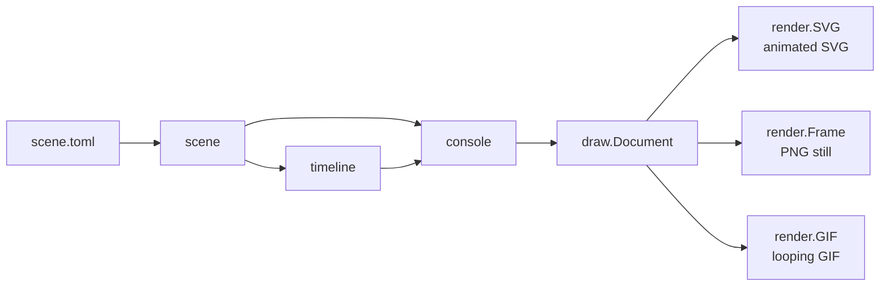

# Architecture

Beaconcast separates what happens in a demo from how the console draws it and
how the result is encoded:

`scene` parses and validates a scene file. `timeline` turns its pacing into
absolute times for every keystroke, command, and event, and records when the
session checks in. `console.Build` combines the scene and timeline into a
`draw.Document`: static shapes plus timed elements, each visible from a start
time until an end time.

The console lays out the transcript at full length and passes it through a
scrolling helper that moves lines up as new output arrives, keeping the
window within its maximum height. It scrolls by whole lines, so a line is
always either fully visible or gone.

Renderers never see the scene. `render.SVG` gives each timed element a CSS
animation that toggles its opacity once per loop and embeds a font subset.
`render.Frame` draws the shapes visible at one moment in pure Go, and
`render.GIF` encodes a sequence of such frames, storing only changed pixels.
Because every output draws the same shapes, the SVG and the GIF cannot drift
apart, and tests compare GIF frames with directly rendered frames.

The CLI in `internal/cli` is an adapter over these packages and has no
privileged access to them. `internal/fonts` embeds JetBrains Mono, subsets it
for SVG output, and provides raster faces.
